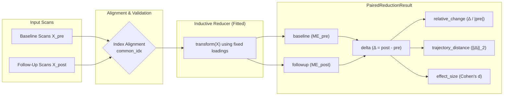

# Reducers (Algorithms)

**eigenradiomics** is designed around a modular scaffolding that aggregates diverse dimensionality reduction techniques under a unified scikit-learn compatible interface. The core objective is to compress a wide feature matrix \(X \in \mathbb{R}^{n \times m}\) into a dense subspace \(Y \in \mathbb{R}^{n \times k}\) where \(k \ll m\), while preserving meaningful latent structure and enabling transfer of the learned reduction to new, unseen data.

This is particularly critical when working with high-dimensional radiomic feature tables, such as those produced by [Pictologics](https://github.com/martonkolossvary/pictologics), where hundreds or thousands of correlated features must be distilled into a tractable set of components for downstream predictive modelling.

---

## Unified Reducer Contract

While different algorithms operate under distinct statistical assumptions, all reducers in this package adhere to a shared set of guarantees:

1. **Dense Matrices**: All methods operate on dense NumPy backends.
2. **Prior Scaling**: Dimensionality reduction models are sensitive to scale differences. Continuous features should be preprocessed (winsorized, power-transformed, and \(z\)-scored) prior to passing to a reducer.
3. **Reproducible Loadings & No Leakage**: Inductive reducers fit and cache internal parameters (e.g., eigenvector bases, singular value loadings, module assignments) during `.fit()`. This ensures that `.transform()` on new data produces deterministic mappings without re-computing the reduction, strictly preventing data leakage.
4. **Inverse Transform**: Where mathematically supported, reducers implement `.inverse_transform()` to project from the reduced subspace back to the original feature space.
5. **Full Parameter Exposure**: Every hyperparameter is exposed through the standard `get_params()` / `set_params()` interface for `GridSearchCV` and `Pipeline` compatibility.

---

## Inductive vs. Transductive Reducers

Reducers are categorized based on their ability to project out-of-sample data:

* **Inductive Reducers** (`WGCNAReducer`, `PCAReducer`, `SparsePCAReducer`, `UMAPReducer`, `IsomapReducer`, `LLEReducer`): Learn parametric or kernel projection operators during `fit()` and can project unseen samples via `transform()` and `transform_paired()`.
* **Transductive Reducers** (`TSNEReducer`, `MDSReducer`, `SpectralReducer`): Optimize low-dimensional coordinates directly for the training set and do not support out-of-sample transformation. Calling `transform()` or `transform_paired()` raises an informative `NotImplementedError`.

---

## Longitudinal & Paired Analysis (`transform_paired`)

Longitudinal imaging studies require comparing baseline ($X_{\text{pre}}$) and follow-up ($X_{\text{post}}$) feature spaces without recalculating latent embeddings. All inductive reducers implement `transform_paired()` on `BaseReducer`:



### Example: Paired Treatment Response

```python
from eigenradiomics import PCAReducer, WGCNAReducer

# Fit inductive reducer on baseline scans
reducer = WGCNAReducer(soft_power=6, min_module_size=20)
reducer.fit(X_baseline_df)

# Compute paired longitudinal trajectory metrics
paired = reducer.transform_paired(
    X_pre=X_baseline_df,
    X_post=X_followup_df,
    relative=True,
    compute_distance=True,
)

# Extract aligned metrics
print(paired.delta.head())              # Latent shifts per module
print(paired.trajectory_distance.head()) # Overall Euclidean trajectory length
print(paired.effect_size)                # Cohen's d per module

# Merge into a single wide table for survival / classification models:
wide_df = paired.to_dataframe(prefix_mode="suffix")
print(wide_df.columns)
# -> ['wgcna_0_baseline', 'wgcna_0_followup', 'wgcna_0_delta', 'wgcna_0_relative_change', 'trajectory_distance']
```

---

## Reduction Artifacts

Beyond the transformed matrix, a reducer can expose **structured intermediate outputs** for downstream plotting and analysis through one uniform interface:

```python
artifacts = reducer.get_reduction_artifacts()
artifacts.available()    # ['similarity', 'linkage', 'cluster_labels', 'feature_order', 'feature_importances']
artifacts.similarity     # feature × feature DataFrame, or None
```

| Element | Meaning |
|---------|---------|
| `feature_names` | Input feature names (always present) |
| `similarity` | Symmetric feature × feature similarity (e.g. WGCNA TOM) |
| `linkage` | SciPy hierarchical-clustering linkage matrix |
| `cluster_labels` | Per-feature cluster / module label |
| `feature_order` | Features in a meaningful display order (e.g. dendrogram leaves) |
| `feature_importances` | Per-feature contribution to the reduction |

---

## Reducers Directory

| Reducer | Category | Description |
| :--- | :--- | :--- |
| [`WGCNAReducer`](wgcna.md) | Inductive | Weighted Gene Co-expression Network Analysis with missingness & sign alignment. |
| [`PCAReducer`](pca.md) | Inductive | Standard linear Principal Component Analysis with full reconstruction support. |
| [`SparsePCAReducer`](pca.md) | Inductive | Sparse PCA with $L_1$ penalty yielding sparse, interpretable loadings. |
| [`UMAPReducer`](../user_guide/embeddings.md) | Inductive | Uniform Manifold Approximation and Projection for non-linear manifold learning. |
| [`IsomapReducer`](../user_guide/embeddings.md) | Inductive | Isometric feature mapping preserving geodesic manifold distances. |
| [`LLEReducer`](../user_guide/embeddings.md) | Inductive | Locally Linear Embedding preserving local neighborhood geometries. |
| [`PaCMAPReducer`](../user_guide/embeddings.md) | Inductive | Pairwise Controlled Manifold Approximation preserving local & global structure. |
| [`TriMAPReducer`](../user_guide/embeddings.md) | Inductive | Triplet-based dimensionality reduction preserving global topology. |
| [`TSNEReducer`](../user_guide/embeddings.md) | Transductive | t-Distributed Stochastic Neighbor Embedding for visualization. |
| [`MDSReducer`](../user_guide/embeddings.md) | Transductive | Multidimensional Scaling on pairwise Euclidean distances. |
| [`SpectralReducer`](../user_guide/embeddings.md) | Transductive | Spectral graph embedding using normalized graph Laplacians. |
