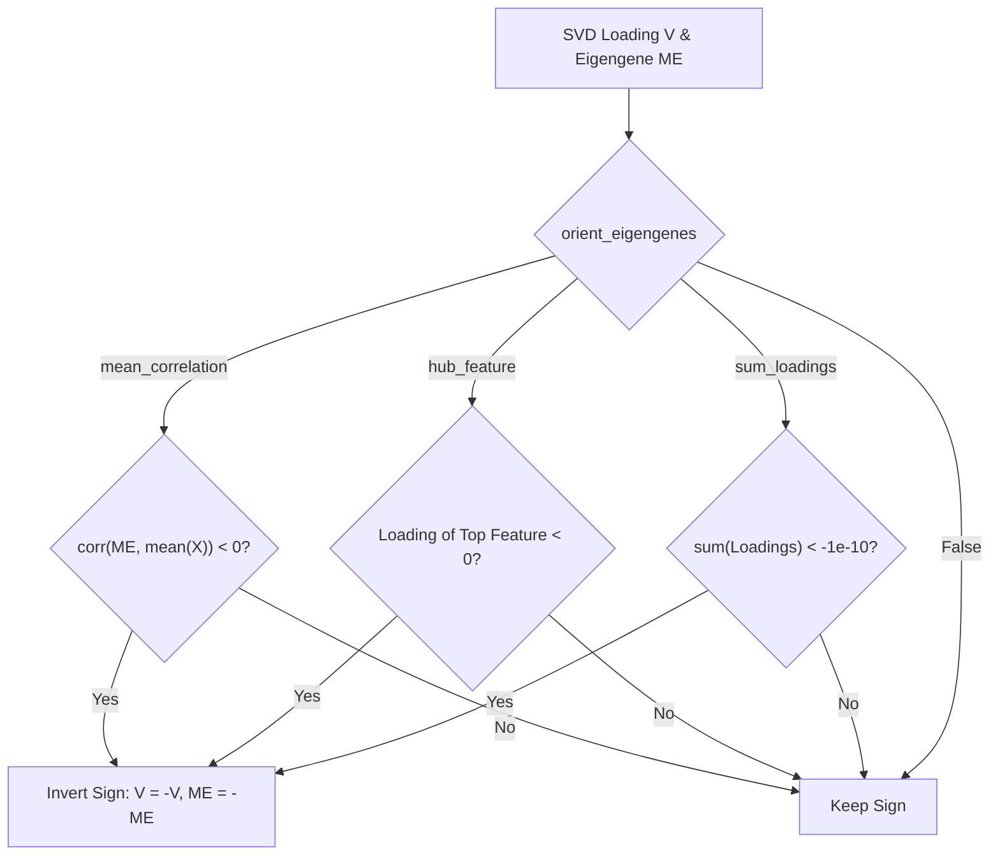

# WGCNA Reducer (Weighted Gene Co-expression Network Analysis)

`WGCNAReducer` is an unsupervised reducer, originally developed for gene-expression data and built on the `PyWGCNA` backend. It groups tightly correlated features into modules and represents each module by a single summary variable (its eigengene), turning a very wide feature matrix into a small set of module-level components. The fitted loadings are stored so the same mapping can be applied to new data.

```mermaid
flowchart LR
    X([Feature Matrix<br/>(NaN-Safe)]) --> M_STRAT{Missing<br/>Strategy}
    M_STRAT -->|Impute| X_IMP[Imputed Features]
    M_STRAT -->|Pairwise| CORR[Pairwise Correlation<br/>Matrix R]
    X_IMP --> A1["Adjacency<br/>|corr|^β"]
    CORR --> A2["Direct Adjacency<br/>S^β"]
    A1 --> T[Topological<br/>Overlap Matrix]
    A2 --> T
    T --> D[Hierarchical clustering<br/>on 1 − TOM]
    D --> M["Modules<br/>(≥ min_module_size)"]
    M --> G[Merge similar<br/>modules]
    G --> ORIENT{Sign<br/>Alignment}
    ORIENT --> E[Module eigengenes<br/>SVD loadings stored]
    E --> Y([Reduced Y<br/>wgcna_0, wgcna_1, ...])
```

---

## Mathematical Formulation

Unlike global factorization methods such as Principal Component Analysis, which decompose variance across all features at once, WGCNA works bottom-up: it builds a feature-to-feature similarity network and derives modules from its structure.

### 1. Adjacency Matrix

Initial variable clusters are extracted by estimating continuous topological distances between inputs across the feature plane. A power function soft-thresholds the Pearson correlation metric \(\text{corr}(x_i, x_j)\), driving weak connections toward zero and enhancing significant overlaps asymptotically.

\[
A_{ij} = \lvert \text{corr}(x_{i}, x_{j}) \rvert ^ {\beta}
\]

Where \(\beta\) (`soft_power`) represents the scaling amplification factor maximizing scale-free topological dependencies. 

### 2. Topological Overlap Matrix (TOM)

To protect clustering boundaries against localized noise spikes, the Adjacency mapping transfers to evaluating shared neighbourhood dependencies via the Topological Overlap Matrix:

\[
\text{TOM}_{ij} = \frac{\sum_u A_{iu} \cdot A_{uj} + A_{ij}}{\min(K_i, K_j) + 1 - A_{ij}}
\]

Dissimilarity matrices are constructed as \(1 - \text{TOM}_{ij}\). Hierarchical clustering is then applied to this dissimilarity, iteratively grouping the most tightly connected features into modules (bounded by `min_module_size`).

### 3. Latent Vector Mapping (Module Eigengenes)

Each module is summarized by one or more components so the reduction can be applied consistently to new data.

Every identified module represents a cluster of highly correlated features. Each module is represented by its Module Eigengene ($Y_{\text{mod}}$), which is derived via Singular Value Decomposition (SVD) across the centered and scaled features belonging **only** to that module:

\[
X^{(\text{scaled})} = U \Sigma V^T
\]

For each module, we compute and store the loading matrix $V_{1..k}$ containing the top $k$ singular vectors:

\[
Y_{\text{mod}} = X^{(\text{scaled})} \cdot V_{1..k}
\]

* **If $k = 1$**: The loading is a 1-D vector $V_1 \in \mathbb{R}^{d}$, and $Y_{\text{mod}} \in \mathbb{R}^{n \times 1}$.
* **If $k > 1$**: The loading is a 2-D matrix $V_{1..k} \in \mathbb{R}^{d \times k}$, and $Y_{\text{mod}} \in \mathbb{R}^{n \times k}$.

The loading weights are stored during `.fit()` and reused during `.transform()` to project unseen data deterministically without re-running the clustering. This is also the basis for `.inverse_transform()`, which reconstructs an approximation of the original feature space from the reduced representation using the transpose of the loading matrix ($Y_{\text{mod}} \cdot V_{1..k}^T$).

---

## Native Missing Data Handling (`missing_strategy`)

Radiomics feature matrices frequently suffer from missing values due to organ absence, small segmentation volumes, or protocol variations. `WGCNAReducer` natively accommodates missing values via the `missing_strategy` parameter:

| Strategy | Description | Best Used For |
| :--- | :--- | :--- |
| `"raise"` | Strict default: raises `ValueError` if NaNs are detected. | Complete data pipelines with upstream imputation. |
| `"zero"` | Fills NaNs with `0.0` across training and unseen test scans. | Delta / longitudinal change matrices ($\Delta X = X_{\text{post}} - X_{\text{pre}}$). |
| `"floor"` | Imputes NaNs with the feature-wise minimum observed in training data. | Absent anatomy / sub-threshold signal (zero physical volume). |
| `"mean"` | Imputes NaNs with the feature-wise mean observed in training data. | General missing-at-random (MAR) radiomics features. |
| `"median"` | Imputes NaNs with the feature-wise median observed in training data. | Heavy-tailed or skewed feature distributions. |
| `"pairwise"` | Computes pairwise-complete correlation matrix for network construction without global matrix imputation. | Incomplete datasets where pairwise correlations are reliable. |

```mermaid
flowchart TD
    A["Raw Input X (with NaNs)"] --> B{"missing_strategy"}
    B -->|"raise"| C["Raise ValueError"]
    B -->|"zero"| D["Impute 0.0"]
    B -->|"floor"| E["Impute Train Min"]
    B -->|"mean" / "median"| F["Impute Train Mean/Median"]
    B -->|"pairwise"| G["Pairwise Complete Corr Matrix R"]
    G --> H["Derive Similarity S & Soft Power"]
    H --> I["Direct Adjacency A = S^β"]
    I --> J["TOM & Modules"]
    D --> K["Standard PyWGCNA Pipeline"]
    E --> K
    F --> K
    J --> L["Projection with NaN-Safe SVD"]
    K --> L
```

---

## Automated Sign Alignment (`orient_eigengenes`)

Because SVD factorizations possess sign ambiguity ($X = U \Sigma V^T = (-U)\Sigma (-V)^T$), the mathematical sign of an eigengene is arbitrary. `orient_eigengenes` resolves this ambiguity to guarantee biological and physical interpretability:

* **`"mean_correlation"`** (default, or `True`): Ensures positive correlation with module mean expression ($\text{corr}(ME, \bar{X}) > 0$). Positive eigengene values always correspond to higher radiomic intensity or complexity.
* **`"hub_feature"`**: Ensures that the dominant loading feature has a positive loading ($V_{\arg\max |V|, k} > 0$) across all extracted components $k \ge 1$.
* **`"sum_loadings"`**: Ensures that the sum of loadings is positive ($\sum V_j > 0$).
* **`False`**: Preserves the raw SVD orientation.



---

## Functional Catalog Over-Representation Analysis (ORA)

Discovered WGCNA modules can be functionally characterized by testing for over-representation of metadata categories (such as IBSI feature families, image filters, or anatomical compartments) from a [`FeatureCatalog`](../api/ingestion.md):

```python
from eigenradiomics import FeatureCatalog, WGCNAReducer

# Fit WGCNA on radiomics features
reducer = WGCNAReducer(soft_power=6, min_module_size=20)
reducer.fit(X_df)

# Run Over-Representation Analysis across all catalog families
catalog = FeatureCatalog.from_csv("feature_catalog.csv")   # Pictologics describe_features() table
enrichment = reducer.get_catalog_enrichment(catalog, columns=["family", "family_group"])
print(enrichment.head())
```

| catalog_column | cluster | group | n_overlap | cluster_size | group_size | total_features | p_value | odds_ratio | fdr_q_value |
| :--- | :--- | :--- | :--- | :--- | :--- | :--- | :--- | :--- | :--- |
| `family` | `dimgrey` | `glcm` | 32 | 45 | 40 | 180 | 1.4e-12 | 14.2 | 2.8e-11 |
| `family` | `silver` | `firstorder` | 28 | 35 | 36 | 180 | 3.1e-14 | 18.5 | 9.3e-13 |

---

## Python Interface

```python
from eigenradiomics import WGCNAReducer

reducer = WGCNAReducer(
    soft_power="auto",
    min_module_size=30,
    me_diss_threshold=0.2,
    missing_strategy="pairwise",
    orient_eigengenes="mean_correlation",
    n_module_components=1,
)

# Fit on training data with missingness
Y_train = reducer.fit_transform(X_train)

# Project new samples without data leakage:
Y_test = reducer.transform(X_test)

# Invert back to original space:
X_recon = reducer.inverse_transform(Y_test)
```

---

## Diagnostics

The reducer exposes helper methods to inspect the fitted model:

- `wgcna_get_module_assignments()` — features assigned to each module
- `wgcna_get_module_sizes()` — number of features per module
- `wgcna_get_feature_importances()` — per-feature SVD loadings within each module
- `wgcna_get_soft_power_table()` — scale-free topology table (when `soft_power="auto"`)
- `wgcna_plot_soft_power()` — soft-power diagnostic plot
- `wgcna_plot_dendrogram()` — feature dendrogram with module colour bar
- `get_catalog_enrichment()` — over-representation analysis against feature catalogs

---

## Parameter Guide

| Parameter | Default | Guidance |
|-----------|---------|----------|
| `network_type` | `"signed hybrid"` | How correlations are turned into adjacencies: `"signed hybrid"`, `"signed"`, or `"unsigned"`. Signed variants keep the direction of correlation. |
| `tom_type` | `"signed"` | Topological Overlap Matrix type: `"signed"` or `"unsigned"`. |
| `correlation_method` | `"pearson"` | `"pearson"` or `"spearman"`. Spearman rank-transforms features for network construction (robust to monotone non-linearities) while keeping eigengene loadings on the original scale. |
| `soft_power` | `"auto"` | Soft-thresholding power $\beta$ for the adjacency matrix. `"auto"` picks the lowest power that meets the scale-free criteria (R², mean connectivity, negative slope); an integer fixes it for deterministic pipelines. |
| `soft_power_fallback` | `"best_r2"` | What `soft_power="auto"` does when no power meets the criteria. `"best_r2"` warns, uses the power with the highest R², and sets `soft_power_criteria_met_` to False. `"raise"` raises a `ValueError`. |
| `r_squared_cut` | `0.9` | Target R² for scale-free topology when `soft_power="auto"`. Lower it if automatic selection fails to reach the threshold. |
| `mean_cut` | `100` | Mean-connectivity ceiling used during automatic soft-power selection. |
| `power_min`, `power_max` | `1`, `30` | Inclusive range of candidate powers evaluated when `soft_power="auto"`. |
| `min_module_size` | `50` | Minimum number of features per module. Smaller values yield more, finer modules. |
| `me_diss_threshold` | `0.2` | Module-eigengene dissimilarity threshold for merging similar modules (0–1). |
| `deep_split` | `2` | `cutreeHybrid` sensitivity (0–4); higher splits the dendrogram more aggressively into smaller modules. |
| `pam_respect_dendro` | `False` | Whether the PAM stage of `cutreeHybrid` respects the dendrogram. |
| `include_grey` | `False` | If `True`, keep unassigned ("grey") features as an extra pseudo-module; if `False` (default), they are excluded from the output. |
| `store_tom` | `False` | Keep the Topological Overlap Matrix as `tom_`. Memory-intensive ($O(m^2)$). |
| `n_module_components` | `1` | Number of principal components (eigengenes) to extract per module. Setting $k > 1$ captures richer intra-module variation. |
| `missing_strategy` | `"raise"` | `"raise"`, `"zero"`, `"floor"`, `"mean"`, `"median"`, or `"pairwise"`. Handles NaNs in radiomics matrices. |
| `orient_eigengenes` | `"mean_correlation"` | `"mean_correlation"`, `"hub_feature"`, `"sum_loadings"`, or `False`. Resolves SVD sign ambiguity. |
| `n_jobs` | `None` | Number of parallel jobs for per-module SVD and projection. `None`/`1` is sequential; `-1` uses all CPU cores. |
| `verbose` | `0` | `0` suppresses PyWGCNA stdout; `>= 1` passes it through. |
| `log_file` | `None` | If set, redirect PyWGCNA stdout to this file instead of the console. |

---

## References

- Langfelder, P., & Horvath, S. (2008). **WGCNA: an R package for weighted correlation network analysis**. *BMC Bioinformatics*, 9, 559. [PubMed](https://pubmed.ncbi.nlm.nih.gov/19114008/)
- Rezaie, N., et al. (2023). **PyWGCNA: A Python package for weighted gene co-expression network analysis**. *Bioinformatics*, 39(7). [PubMed](https://pubmed.ncbi.nlm.nih.gov/37399090/)
