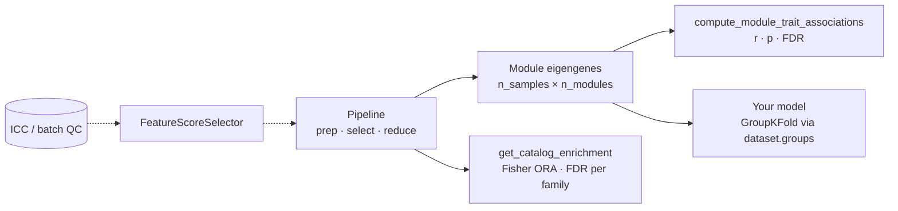

# Downstream Statistical Analysis

The reducer turns a wide feature matrix into a handful of **module eigengenes**.
This page shows how to take those eigengenes (and the reduction artifacts) into
statistical analysis: module–trait associations, over-representation analysis,
QC-driven feature selection, and leakage-safe modelling.



---

## Get Labeled Eigengenes

`WGCNAReducer.transform` returns a NumPy array. To carry the **sample index** and
**eigengene names** (`wgcna_0`, `wgcna_1`, …) into downstream stats, opt into
scikit-learn's pandas output:

```python
from eigenradiomics import WGCNAReducer

reducer = WGCNAReducer(soft_power="auto", min_module_size=20, store_tom=True)
reducer.set_output(transform="pandas")          # eigengenes come back as a DataFrame
eigengenes = reducer.fit_transform(X)            # index = samples, columns = wgcna_*
```

`set_output(transform="pandas")` works on the whole `Pipeline` too, so the final
step's output keeps its labels.

---

## Module–Trait Relationships

`compute_module_trait_associations` correlates each module eigengene with each
clinical trait and reports the coefficient, its p-value, and a
Benjamini-Hochberg FDR across the table — the standard WGCNA *module–trait
relationship*. Mixed-type traits are encoded automatically.

```python
from eigenradiomics import compute_module_trait_associations

mtr = compute_module_trait_associations(
    eigengenes,                      # samples × modules
    dataset,                         # a RadiomicsDataset (or a traits DataFrame)
    ["Age", "Stage", "Sex", "Event"],
    method="spearman",
)
mtr["r"]       # modules × traits correlation matrix
mtr["p"]       # matching p-values
mtr["p_fdr"]   # Benjamini-Hochberg FDR
```

`mtr["r"]` (with `mtr["p_fdr"]` for significance) is a compact summary linking the
reduced space to outcomes.

---

## Feature Hubness and Module Membership

To identify the central drivers representing each module's holistic co-expression score, use:
- **`compute_module_membership`**: Calculates Module Membership ($k_{\text{ME}}$) for every raw feature against the module eigengenes.
- **`identify_hub_features`**: Pinpoints the raw radiomic features that are the absolute most central "hubs" of their assigned modules.

```python
from eigenradiomics import compute_module_membership, identify_hub_features

# Calculate k_ME matrix (features x modules)
k_me = compute_module_membership(X, reducer=reducer)

# Find top hub feature representing each module
hubs_df = identify_hub_features(
    X,
    cluster_labels=reducer.get_reduction_artifacts().cluster_labels,
    reducer=reducer,
    top_n=1,
)
print(hubs_df)  # Columns: cluster, feature, k_ME, rank
```

You can plot this relationship dynamically and accessibly (complying with OUP science figure guidelines):

```python
from eigenradiomics.plotting import plot_hub_significance

# clinical_assoc: a Series of feature name -> association with a trait (e.g. |r|)
# PyWGCNA chooses the module names, so read them from the fitted reducer
target = reducer.module_names_[0]

# Plot k_ME vs. raw association strength
fig = plot_hub_significance(
    k_me,
    feature_significance=clinical_assoc,
    cluster_labels=reducer.get_reduction_artifacts().cluster_labels,
    target_cluster=target,
    path="accessible_hub_plot.png",
)
```

---

## Radiomics Feature Group Over-Representation Analysis (ORA)

Over-Representation Analysis determines whether features belonging to a particular functional family, filter class, or anatomical compartment are statistically enriched within discovered co-expression modules.

### Using `reducer.get_catalog_enrichment()`

You can query enrichment directly from a fitted reducer or a [`ReductionArtifacts`](../reducers/index.md#reduction-artifacts):

```python
from eigenradiomics import FeatureCatalog, WGCNAReducer

reducer = WGCNAReducer(soft_power=6, min_module_size=20)
reducer.fit(X_df)

catalog = FeatureCatalog.from_csv("feature_catalog.csv")   # Pictologics describe_features() table

# Test enrichment across multiple catalog columns:
enrichment_df = reducer.get_catalog_enrichment(
    catalog,
    columns=["family", "family_group"],
    method="fisher",         # "fisher" | "chi2" | "hypergeometric"
    alternative="greater",   # "greater" (enrichment) | "less" (depletion) | "two-sided"
)
print(enrichment_df.head())
```

### Statistical Methods & Group-Wise FDR Correction

* **`method="fisher"`** (default): Exact Fisher's test on the $2 \times 2$ contingency table.
* **`method="hypergeometric"`**: One-tailed hypergeometric test evaluating the probability of observing $\ge k$ overlaps given background population size $M$.
* **`method="chi2"`**: Fast asymptotic Chi-squared contingency test.
* **Group-Wise FDR**: When multi-column catalogs are passed, Benjamini-Hochberg FDR correction is applied **strictly per `catalog_column` family**, preserving the independence of separate hypothesis spaces.

---

## Eigengene Profiles across Target Groups

To display the level or trajectory of module co-expression throughout disease progression or patient grades:

```python
from eigenradiomics.plotting import plot_eigengene_profiles

# Grouped Boxplot (with accessible hatching and strip overlay)
fig_box = plot_eigengene_profiles(eigengenes, dataset.data["Grade"], trait_name="Grade")

# Continuous Scatter (with regression fit line and Pearson r score annotation)
fig_scatter = plot_eigengene_profiles(
    eigengenes, dataset.data["SurvivalTime"], trait_name="Survival Days"
)
```

---

## Reproducibility Synteny Plot

To visually compare feature reproducibility (e.g. ICC or correlation) between two observers/readers, you can use `plot_reproducibility_synteny`. It displays features along parallel vertical axes with color-coded connection lines representing reproducibility scores:

```python
from eigenradiomics.plotting import plot_reproducibility_synteny

fig = plot_reproducibility_synteny(
    reproducibility_results,    # DataFrame from compute_reproducibility
    catalog=catalog,            # FeatureCatalog for family grouping
    metric="icc",               # Inferred metric to plot
    order=custom_order_names,   # Optional custom ordering
    title="Reproducibility Synteny",
)
```

---

## RWAS Manhattan Plot

The Radiomics Wide Association Study (RWAS) Manhattan plot displays association p-values ($-\log_{10} p$) on the vertical axis against features grouped by their family on the horizontal axis:

```python
from eigenradiomics.feature_models import plot_rwas_manhattan
from eigenradiomics.plotting import Bar, CorrPanel, Strip

# Prepare optional annotation tracks
strip = Strip(catalog.frame.set_index("feature")["family_group"])
bar = Bar(reproducibility_results["ICC"].set_index("feature")["icc_2_1"], title="ICC")
corr_panel = CorrPanel(correlations_df)

# Render Manhattan plot with bottom tracks
fig = plot_rwas_manhattan(
    association_result,
    catalog=catalog,
    tier="Univariable",
    strips=[strip],
    bars=[bar],
    corr_panel=corr_panel,
    title="RWAS Manhattan Plot",
)
```

---

## QC-Driven Feature Selection in a Pipeline

```python
from sklearn.pipeline import Pipeline
from eigenradiomics import (
    FeatureScoreSelector,
    RadiomicsPrepTransformer,
    WGCNAReducer,
    compute_reproducibility,
)

repro = compute_reproducibility([reader1, reader2])          # per-feature ICC
icc = repro["ICC"]                                            # has 'feature' + 'icc_2_1'

pipe = Pipeline([
    ("prep", RadiomicsPrepTransformer().set_output(transform="pandas")),
    ("reliable", FeatureScoreSelector(icc, threshold=0.80, score_column="icc_2_1")),
    ("reduce", WGCNAReducer(soft_power="auto", min_module_size=20)),
]).set_output(transform="pandas")
```

---

## Feeding Eigengenes into a Model (Leakage-Safe CV)

```python
from sklearn.linear_model import LogisticRegression
from sklearn.model_selection import GroupKFold, cross_val_score
from sklearn.pipeline import Pipeline
from eigenradiomics import WGCNAReducer

X, y = dataset.to_pipeline_input()
cv = GroupKFold(n_splits=5)
scores = cross_val_score(
    Pipeline([
        ("reduce", WGCNAReducer(soft_power="auto", min_module_size=20)),
        ("clf", LogisticRegression()),
    ]),
    X,
    y,
    groups=dataset.groups,
    cv=cv,
)
```
