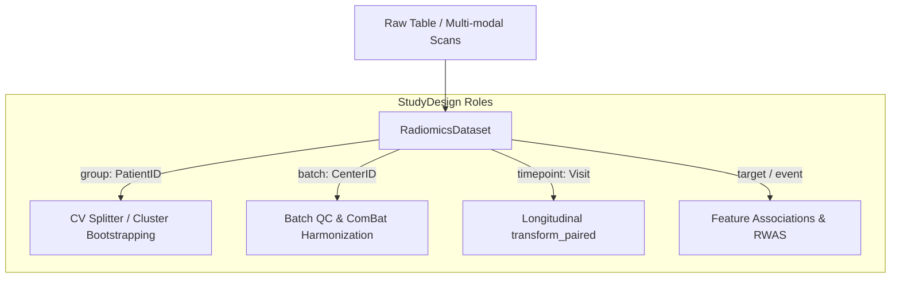

# Input Data Model

eigenradiomics accepts generic feature matrices with shape `n_samples x n_features`.

## Accepted Input Types

| Input type <div style="min-width: 180px;"></div> | Supported | Notes |
|:--|:--:|:--|
| `numpy.ndarray` | Yes | Synthetic feature names are generated internally (`feature_0`, `feature_1`, ...) |
| `pandas.DataFrame` | Yes | Column names are preserved and validated across `fit` / `transform` |

## Row and Column Semantics

- **Rows** correspond to samples, studies, patients, lesions, or any observation-level unit.
- **Columns** correspond to features.

This is the same orientation expected by scikit-learn and by the low-level PyWGCNA static functions used inside `WGCNAReducer`.

## Feature Identity Rules

When you fit on a DataFrame, the estimator stores the feature names it saw during `fit`.

During `transform`:

- missing columns are rejected
- unexpected extra columns are rejected
- the same columns in a different order are rejected

This is especially important for wide radiomics tables, where a column-order mismatch can produce plausible-looking but wrong transformed outputs.

!!! warning "Do not reorder columns between fit and transform"
    If your upstream feature engineering pipeline changes column order, reindex the new DataFrame back to the fitted feature order before calling `transform`.

## Interaction with sklearn Preprocessors

Many scikit-learn preprocessors emit `numpy.ndarray` outputs rather than `pandas.DataFrame` objects. That is fully compatible with eigenradiomics reducers.

When a reducer receives an ndarray after upstream preprocessing:

- synthetic feature names are generated internally
- transform-time validation falls back to feature order rather than original column labels

Use the same fitted sklearn pipeline for train and inference to preserve consistency. If you want explicit column-name validation at the reducer boundary, keep the data as a DataFrame until reduction or reconstruct a DataFrame with the intended feature names before fitting the reducer.

## [Pictologics](https://github.com/martonkolossvary/pictologics)-Derived Tables

[Pictologics](https://github.com/martonkolossvary/pictologics) produces wide feature tables where each column is a named radiomics feature. Those tables are a natural input for eigenradiomics because:

- they are already sample-by-feature matrices
- they often contain strong correlation structure
- preserving named columns matters for traceability and interpretability

Recommended pattern:

```python
X = pictologics_results_df
pipe.fit(X_train)
Y_new = pipe.transform(X_new[X_train.columns])
```

## Study Design Roles & Metadata

A key primitive in `eigenradiomics` is the `StudyDesign`, which provides semantic annotations mapping clinical and experimental metadata columns to specific analytical roles:

| Role | Description | Consuming Subsystems |
| :--- | :--- | :--- |
| `group` | Subject / Patient identifier for grouped cross-validation and cluster bootstrapping | `GroupKFold`, `compute_reproducibility` |
| `batch` | Scanner, acquisition center, or manufacturer identifier | `compute_batch_effects`, ComBat harmonization |
| `timepoint` | Longitudinal scan timing or visit order (e.g., `"baseline"`, `"followup"`) | `transform_paired`, longitudinal trajectory analysis |
| `target` | Supervised continuous or categorical outcome | `compute_feature_associations`, RWAS models |
| `time` | Survival follow-up time (use it together with `event`) | Cox proportional hazards models |
| `event` | Survival censoring indicator (1 = event, 0 = censored) | Cox proportional hazards models |



## Longitudinal & Paired Study Designs

In longitudinal studies where patients undergo repeated imaging (e.g., pre-treatment vs post-treatment, or baseline vs surveillance), repeated scans share within-subject correlations that must be accounted for during both quality control and downstream evaluation.

```python
from eigenradiomics import RadiomicsDataset, StudyDesign

# Specify subject grouping and timepoints
design = StudyDesign(roles={
    "group": "PatientID",
    "batch": "ScannerID",
    "timepoint": "Timepoint",
    "target": "TreatmentResponse",
})

dataset = RadiomicsDataset(
    table,
    feature_columns=feature_cols,
    design=design,
    catalog=catalog,
)

# Extract paired scans cleanly
baseline = dataset.features[dataset.metadata["Timepoint"] == "T0"]
followup = dataset.features[dataset.metadata["Timepoint"] == "T1"]
```

## Output Naming

All reducers produce reducer-scoped output names through `get_feature_names_out()`.

Examples:

- `wgcna_0`, `wgcna_1`, `wgcna_2`
- `pca_0`, `pca_1`, `pca_2`
- `umap_0`, `umap_1`