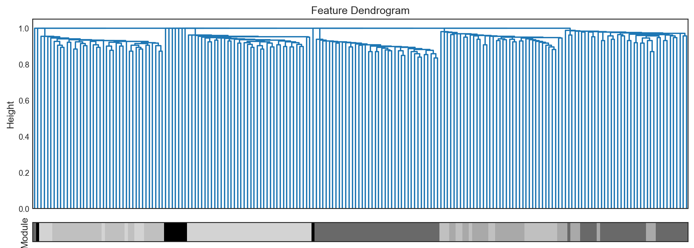

# Quick Start

This guide gets you from a wide feature matrix to a reduced representation with
minimal setup.

## Install

```bash
pip install 'eigenradiomics[wgcna]'   # WGCNA backend included
```

See [Installation](installation.md) for the `combat` extra and development setup.

## Minimal example

```python
import pandas as pd
from sklearn.feature_selection import VarianceThreshold
from sklearn.impute import SimpleImputer
from sklearn.pipeline import Pipeline
from sklearn.preprocessing import StandardScaler

from eigenradiomics import WGCNAReducer

# X is a samples x features table.
X = pd.read_csv("radiomics_features.csv")

pipe = Pipeline(
    [
        ("impute", SimpleImputer(strategy="median")),
        ("var", VarianceThreshold(threshold=0.0)),
        ("scale", StandardScaler()),
        ("reduce", WGCNAReducer(soft_power="auto", min_module_size=30)),
    ]
)

Y = pipe.fit_transform(X)
print(Y.shape)   # (n_samples, n_modules)
```

The output `Y` is an \\(n \\times k\\) matrix with `k << m` and reducer-specific
output names such as `wgcna_0`, `wgcna_1`, ... Upstream preprocessing stays in
the same pipeline.

!!! tip "Feature scale and WGCNA"
    WGCNA builds its network from correlations. It also standardizes the features
    of each module before it calculates the eigengene. Thus, a positive rescale
    or shift of a feature (for example, a change of units) does not change the
    WGCNA result. The `StandardScaler` step is not necessary for WGCNA, but PCA
    and most other reducers need it. Steps that change the shape of a
    distribution, such as winsorizing or Yeo-Johnson in
    [`RadiomicsPrepTransformer`](radiomics_preprocessing.md), do change the
    correlations.

!!! warning "Missing values"
    PyWGCNA can hang on `NaN`/`Inf`. Impute (e.g. `SimpleImputer`) **before** the
    reducer. A `VarianceThreshold` also removes constant columns that carry no
    signal. See [Troubleshooting](troubleshooting.md).

## Train / test pattern

The core use case is to fit on training data and later apply the same fitted
reducer to unseen samples — without recomputing the network, so no information
leaks from test to train.

```python
from sklearn.model_selection import train_test_split

X_train, X_test = train_test_split(X, test_size=0.2, random_state=42)

pipe.fit(X_train)
Y_train = pipe.transform(X_train)
Y_test = pipe.transform(X_test)
```

If you fit the reducer directly on a pandas DataFrame, later transforms must use
the same feature names in the same order. After upstream sklearn steps convert
the data to an ndarray, validation falls back to feature order. See
[Input Data Model](input_data_model.md).

## Inspect and visualize the fit

```python
reducer = pipe.named_steps["reduce"]

reducer.module_names_                   # module names, e.g. ['dimgrey', 'silver', ...]
reducer.wgcna_get_module_sizes()        # {'dimgrey': 38, 'silver': 35, ...}
reducer.wgcna_get_module_assignments()  # module -> list of feature names
reducer.wgcna_get_soft_power_table()    # scale-free topology table (soft_power="auto")

fig = reducer.wgcna_plot_dendrogram(figsize=(11, 4))
fig.savefig("dendrogram.png", dpi=150)
```

The dendrogram shows how features cluster into modules (the colour bar):



PyWGCNA chooses the module names. Thus, read them from `reducer.module_names_`.
Do not type them in your code.

These diagnostics make it easier to decide whether to keep the auto-selected
soft power or refit with an explicit value. See the
[WGCNA Reducer](../reducers/wgcna.md) guide for the full diagnostic set.

## Going further

- Load and align radiomics with clinical data → [Data Ingestion & Datasets](data_ingestion.md)
- Screen unreliable features → [Reproducibility](reproducibility.md)
- Check scanner/center effects → [Batch Effects](batch_effects.md)
- Tune the reducer inside model selection → [Pipelines & Grid Search](pipelines_and_grid_search.md)
