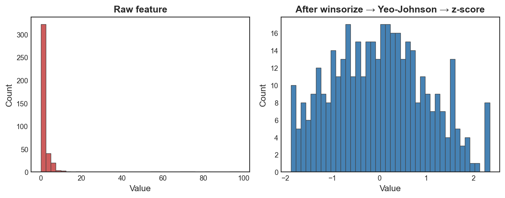
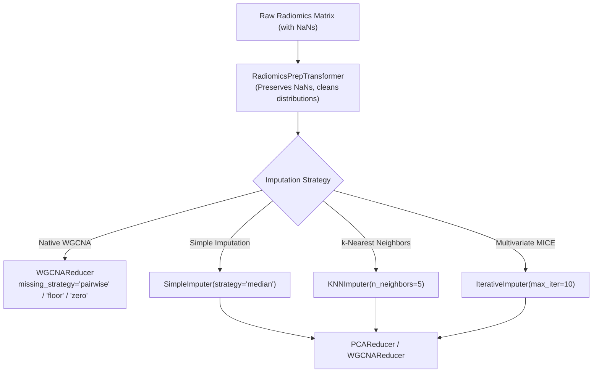

# Radiomics Table Preprocessing

`eigenradiomics.preprocessing` provides utilities for splitting selected
Pictologics wide-format feature columns out of a radiomics table, handling missingness,
and cleaning feature distributions prior to downstream modeling or reduction.

Pictologics wide tables use feature columns named as:

```text
{config}__{feature_key}
```

For example:

```text
standard_fbn_32__volume_RNU0
standard_fbn_32__joint_entropy_TU9B
```

Columns that do not follow this pattern are treated as metadata by default.

---

## Split a CSV Table

```python
from eigenradiomics.preprocessing import split_radiomics_file

result = split_radiomics_file(
    "pictologics_features.csv",
    "preprocessed/",
    features=["volume_RNU0"],
)

print(result.stripped_table)
print(result.removed_table)
```

This writes a stripped radiomics table without the selected feature columns and
a removed-feature table containing metadata columns plus the removed features.

---

## Selector Types

`features` accepts exact feature keys, full column names, and `*` wildcards:

```python
features="volume_RNU0"                    # all configs
features="standard_fbn_32__volume_RNU0"   # one config-feature pair
features="standard_fbn_*__volume_RNU0"    # matching configs
```

`configs` is a global filter over configuration names:

```python
split_radiomics_file(
    "pictologics_features.csv",
    "preprocessed/",
    features="volume_RNU0",
    configs="standard_fbn_*",
)
```

---

## Catalog-Backed Selection

If you provide a Pictologics `describe_features()` catalog, you can select by
granular family or broad family group:

```python
split_radiomics_file(
    "pictologics_features.csv",
    "preprocessed/",
    catalog="feature_catalog.csv",
    family_groups="Texture",
)
```

The catalog should contain `config`, `feature_key`, `family`, and
`family_group` columns. A legacy single `feature` column is also supported when
it contains `{config}__{feature_key}` values.

---

## sklearn Pipeline Use

`RadiomicsFeatureRemover` is a scikit-learn-compatible transformer. Use it when
the removal should be part of a fitted preprocessing pipeline:

```python
from sklearn.pipeline import Pipeline
from sklearn.preprocessing import StandardScaler

from eigenradiomics import RadiomicsFeatureRemover, WGCNAReducer

pipe = Pipeline(
    [
        ("remove", RadiomicsFeatureRemover(features="volume_RNU0")),
        ("scale", StandardScaler()),
        ("reduce", WGCNAReducer(soft_power=6, min_module_size=30)),
    ]
)
```

Like the reducers, the transformer validates that DataFrame columns at
`transform` time match the columns seen during `fit`.

For observer-paired reproducibility tables (`O1_…`, `O2_…` columns), pass
`observer_prefixes=("O1_", "O2_")` so the `configs`/`families`/catalog selectors
resolve on the base `config__feature_key` name.

---

## Selecting Features by a QC Score

`FeatureScoreSelector` drops features that fail a **precomputed** quality
threshold — e.g. low reproducibility ICC or a large batch-effect size — inside a
`Pipeline`. Compute the scores once, pass the table and a threshold, and the
selector becomes part of the fitted, leakage-safe transform:

```python
from eigenradiomics import FeatureScoreSelector

# keep features with ICC >= 0.80 (icc is the "ICC" sheet from compute_reproducibility)
reliable = FeatureScoreSelector(icc, threshold=0.80, score_column="icc_2_1")
```

See [Downstream Statistical Analysis](downstream_analysis.md#qc-driven-feature-selection-in-a-pipeline)
for using it together with the QC functions.

---

## Per-Feature Cleaning with `RadiomicsPrepTransformer`

`RadiomicsPrepTransformer` is a scikit-learn-compatible transformer that
cleans each feature column independently while **preserving NaN values**
(standard sklearn transformers often fail or propagate NaN across a row). For
every column it applies, in order:

1. **Winsorization** — clip values to the `winsor_lower` / `winsor_upper`
   quantiles (defaults 0.01 / 0.99) to tame extreme outliers. The bounds come
   from the training data and also clip new data at `transform`, so quantiles
   0 and 1 still cut external values to the training range. Set a side to
   `None` to turn clipping off there.
2. **Yeo-Johnson** power transform — reduce skew (skip with
   `skip_yeo_johnson=True`). A column that is constant after winsorizing skips
   this step.
3. **Standardization** — z-score to zero mean / unit variance (disable with
   `standardize=False`). A constant column has no spread. Thus, the transformer
   only centers it, and every value becomes 0.

```python
from eigenradiomics.preprocessing import RadiomicsPrepTransformer

prep = RadiomicsPrepTransformer(winsor_lower=0.01, winsor_upper=0.99)
X_clean = prep.fit_transform(X)  # NaNs in X stay NaN in X_clean
```

A right-skewed, outlier-laden feature becomes approximately normal and centered,
while missing values pass straight through:



!!! tip "Order matters"
    Winsorization caps outliers *before* the Yeo-Johnson fit, so a handful of
    extreme values can't dominate the power-transform parameter. A constant column
    does not cause an error. With `standardize=True` (the default), its output is
    0 for every sample. With `standardize=False`, it keeps the constant value
    from `fit`. A column that is all NaN in `fit` stays NaN, with a warning.

The fitted parameters (per-column winsor bounds, power transform, and scaling)
are stored, so `transform` applies exactly the same cleaning to unseen data. As
with the reducers, feature names and order are checked at `transform` time, so a
re-ordered or mismatched table is rejected rather than silently mis-cleaned. A
DataFrame input returns a DataFrame (preserving the index and columns); an
array input returns an array.

---

## Missing Data & Imputation Guide

Missing values in radiomics feature tables require deliberate handling. Depending on whether you want native reducer-level missingness or upstream multivariate imputation within a scikit-learn `Pipeline`, several options are available:



### Approach 1: Native Missingness in `WGCNAReducer`

For WGCNA, native missing handling avoids distorting topological connections:

```python
from eigenradiomics import RadiomicsPrepTransformer, WGCNAReducer
from sklearn.pipeline import Pipeline

pipeline = Pipeline([
    ("prep", RadiomicsPrepTransformer()),
    ("wgcna", WGCNAReducer(
        missing_strategy="pairwise",  # Pairwise complete correlation
        orient_eigengenes="mean_correlation",
    )),
])

Y_train = pipeline.fit_transform(X_train)
Y_test = pipeline.transform(X_test)
```

### Approach 2: Upstream Multivariate Imputation in a `Pipeline`

When using reducers that require complete matrices (such as standard `PCAReducer` or manifold embeddings), place an imputer immediately after `RadiomicsPrepTransformer`:

```python
from sklearn.experimental import enable_iterative_imputer  # noqa: F401
from sklearn.impute import IterativeImputer, KNNImputer, SimpleImputer
from sklearn.pipeline import Pipeline
from sklearn.linear_model import RidgeClassifier
from eigenradiomics import RadiomicsPrepTransformer, PCAReducer

# Option A: Fast univariate median imputation
pipe_median = Pipeline([
    ("prep", RadiomicsPrepTransformer()),
    ("impute", SimpleImputer(strategy="median")),
    ("pca", PCAReducer(n_components=10)),
    ("clf", RidgeClassifier()),
])

# Option B: k-Nearest Neighbors imputation across radiomics profiles
pipe_knn = Pipeline([
    ("prep", RadiomicsPrepTransformer()),
    ("impute", KNNImputer(n_neighbors=5)),
    ("pca", PCAReducer(n_components=10)),
    ("clf", RidgeClassifier()),
])

# Option C: Multivariate Imputation by Chained Equations (MICE)
pipe_mice = Pipeline([
    ("prep", RadiomicsPrepTransformer()),
    ("impute", IterativeImputer(max_iter=10, random_state=42)),
    ("pca", PCAReducer(n_components=10)),
    ("clf", RidgeClassifier()),
])
```

!!! important "Imputation Training vs. Test Leakage"
    By embedding imputers inside a scikit-learn `Pipeline`, imputation statistics (e.g. feature medians, neighbor graphs, regression weights) are fitted **strictly on the training fold** during cross-validation, preventing data leakage into test sets.
